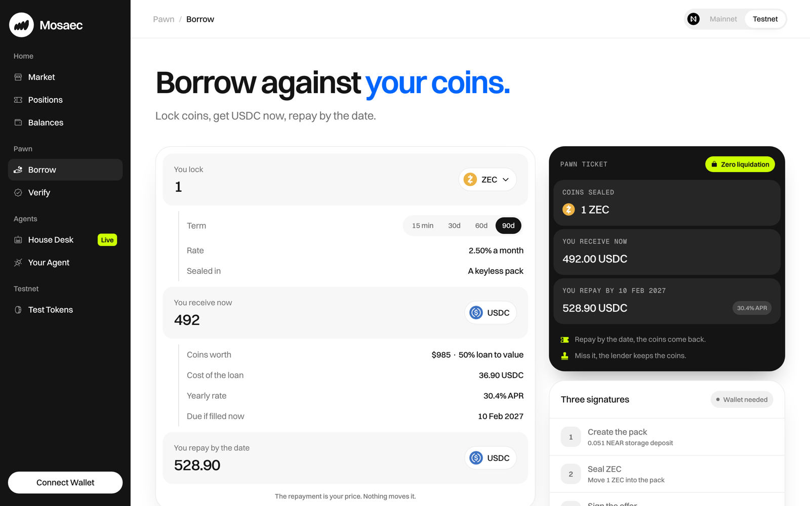
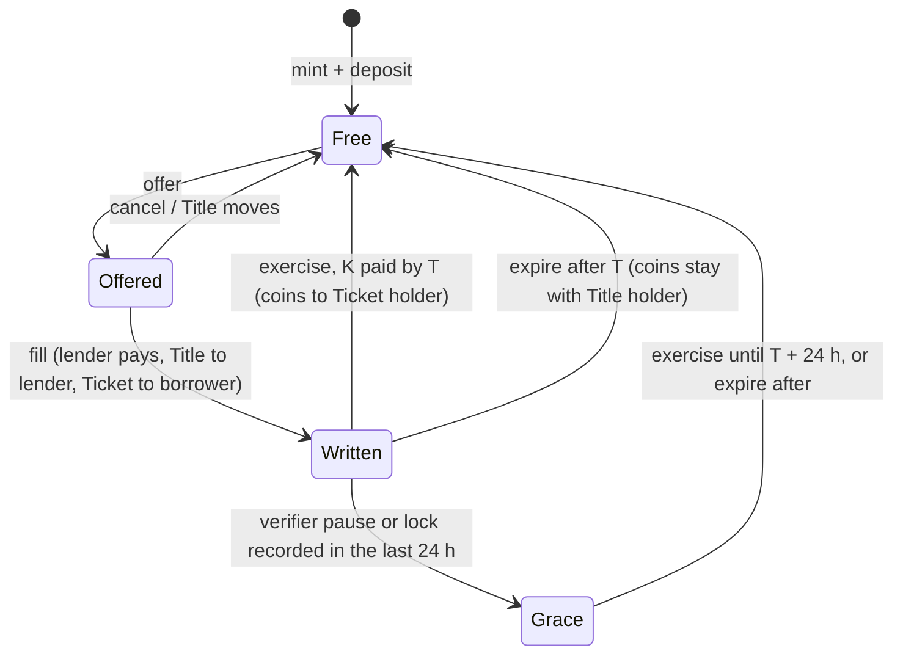

# Mosaec

**Borrow USDC against ZEC, BTC or SOL with one fixed repayment, one fixed date and no liquidation.**
A pawn shop for native coins on NEAR: your coins wait in a sealed account until you pay.

[Live app](https://mosaec.finance/app) · [Site](https://mosaec.finance) · [Registry on NearBlocks](https://testnet.nearblocks.io/address/v0.mosaec.testnet) · [House Desk ledger](https://mosaec.finance/app/desk) · Tracks: `defi`, `nfts`, `business`



## Why

- Why should a one-hour wick take coins from a borrower who would have repaid on time?
- Why should BTC become a custodian's token before it can back a loan?
- Why should a fixed-date deal depend on a price feed at all?
- Why can't the loan itself be something either side can sell?

Over every 90-day window of ZEC history from 2017 to 2026 at 50% loan to value, a liquidating loan
lost the coins in **34.6%** of windows; a pawn lost them in **10.7%**. The numbers
live in [`facts.ts`](<apps/web/app/(site)/_content/facts.ts>) and on [/rates](https://mosaec.finance/rates);
[`scripts/replay`](scripts/replay) recomputes them from the hourly prices committed beside it.

## How It Works

1. **Seal.** You mint a **pack**, a NEAR account with no keys, and move coins into it. The coins sit
   inside the NEAR Intents verifier, held by the pack.
2. **Split.** You offer the pack. A lender fills it: they pay you USDC and receive the **Title**
   NFT (owns the pack). You keep the **Ticket** NFT: the right to take the coins back by paying a
   fixed amount `K` before a fixed date `T`.
3. **Settle.** Pay `K` by `T` and the coins are yours again. Miss `T` and the lender keeps them.
   The contracts read no price; the only events are a payment and a clock.



Simplified: the full machine (a verifier lock also opens Grace; a decided exercise passes through
`Releasing`) is in [`docs/architecture.md`](docs/architecture.md) §4.

Both NFTs are transferable, so a lender can sell a running loan and a borrower can sell the right to
redeem. The **House Desk** is a team-run lender that answers instant borrow requests in about a
minute, prices from an hourly rate card its model proposes inside hard bounds, and publishes its books.
Full design: [`docs/architecture.md`](docs/architecture.md). Desk: [`docs/desk.md`](docs/desk.md).

## Verify It Yourself

Each claim has a check you can run against NEAR testnet or the live API. No wallet needed.

| Claim                                                                                  | Check                                                                                                                                                                                                                                                                                                                                                                     | Expected                                                                                                                                                                      |
| -------------------------------------------------------------------------------------- | ------------------------------------------------------------------------------------------------------------------------------------------------------------------------------------------------------------------------------------------------------------------------------------------------------------------------------------------------------------------------- | ----------------------------------------------------------------------------------------------------------------------------------------------------------------------------- |
| Packs hold coins with **no access keys**                                               | `curl -s https://test.rpc.fastnear.com -H 'content-type: application/json' -d '{"jsonrpc":"2.0","id":1,"method":"query","params":{"request_type":"view_access_key_list","finality":"final","account_id":"0.v0.mosaec.testnet"}}' \| jq -c .result.keys`                                                                                                                   | `[]`                                                                                                                                                                          |
| Pack code **cannot add a key, deploy code or delete itself**                           | build the contracts (see Run Locally), then `python3 -I scripts/check-wasm-imports.py pack=contracts/target/near/mosaec_pack/mosaec_pack.wasm`                                                                                                                                                                                                                            | `pack: 20 imports, batch actions: none`                                                                                                                                       |
| Every pack runs **one published code hash**                                            | `curl -s https://test.rpc.fastnear.com -H 'content-type: application/json' -d '{"jsonrpc":"2.0","id":1,"method":"query","params":{"request_type":"view_account","finality":"final","account_id":"0.v0.mosaec.testnet"}}' \| jq -r .result.global_contract_hash`                                                                                                           | `4NVfLnVFYQxUPfsHRGpU6h8eKmp2AbQxNR2mYNx3Bwzc`, the `pack_code_hash` in the registry's `config` view                                                                          |
| Deployed pack code was **built from this repo**                                        | `curl -s https://test.rpc.fastnear.com -H 'content-type: application/json' -d '{"jsonrpc":"2.0","id":1,"method":"query","params":{"request_type":"call_function","finality":"final","account_id":"0.v0.mosaec.testnet","method_name":"contract_source_metadata","args_base64":"e30="}}' \| jq -r '.result.result \| implode \| fromjson.build_info.source_code_snapshot'` | `git+https://github.com/youvandra/mosaec?rev=c4e55ef…` (NEP-330; CI builds it in the pinned `sourcescan/cargo-near` image, so a local macOS build hashes differently)         |
| A short payment is **refunded**; the full `K` returns the coins                        | testnet txs [`DA6efUeU…`](https://testnet.nearblocks.io/txns/DA6efUeUQLRbLaCYkFU4N1j96XvqGEHR2UKwVuiKnwr5) (K minus 1 unit) and [`FWbhwnW2…`](https://testnet.nearblocks.io/txns/FWbhwnW2LLQy45QfD3gzfXRGsisQ5R249ZeYVi72jPVZ) (K) on pack 0                                                                                                                              | first refunded, pack stays written; second sends 0.5 ZEC back to the borrower                                                                                                 |
| A missed date **keeps the coins** with the lender, no price involved                   | early expire [`BKgwJo7i…`](https://testnet.nearblocks.io/txns/BKgwJo7i3mKc6BgdUGwevZeER1Ud7Qy8twaeMiX7ymc9), expire after T [`2ETfJRTc…`](https://testnet.nearblocks.io/txns/2ETfJRTc6a2buLKQ8i7qapr1x1KGnETYBEtf5ehr2xwK) on pack 1                                                                                                                                      | `E_STATE` before T; after T the lender holds the Title and withdraws 0.5 ZEC in [`cc8UhHaw…`](https://testnet.nearblocks.io/txns/cc8UhHawphno44JNmwWdwyVkk4w81vvR7oCtYQnbwoo) |
| A 90-day pawn at 50% **forfeits in 10.7%** of ZEC windows; a liquidating loan in 34.6% | `python3 -I scripts/replay/rolling_replay.py` (Python 3.11+, standard library, about a second)                                                                                                                                                                                                                                                                            | the line marked `*`: `90d  50%  84262  10.7%  34.6%`                                                                                                                          |
| The desk **quotes at most 50% loan to value**; a fill honours the quoted terms         | `curl -s 'https://mosaec.finance/api/desk/quote?asset=ZEC&amount=50000000&term=2592000000000000&principal=900000000' \| jq .quote.ltvBps`                                                                                                                                                                                                                                 | a number at or below `5000` (the 900 USDC ask is cut to what 0.5 ZEC supports)                                                                                                |
| The desk's books are **public**                                                        | `curl -s https://mosaec.finance/api/desk/ledger \| jq '{state: .status.state, usdc: .treasury.usdc, book: (.book \| {fills, repaid, forfeited})}'`                                                                                                                                                                                                                        | live state, treasury in USDC base units, fills and outcomes                                                                                                                   |
| Kept coins are marked at a **NEAR Intents quote, never executed**                      | after `pnpm install`: `pnpm --filter @mosaec/desk exec vitest run src/intents.test.ts`                                                                                                                                                                                                                                                                                    | 4 tests pass against a recorded 1Click `dry: true` response                                                                                                                   |
| Outside agents can **read and prepare**, never spend                                   | `curl -s -X POST https://mosaec.finance/mcp -H 'content-type: application/json' -H 'accept: application/json, text/event-stream' -d '{"jsonrpc":"2.0","id":1,"method":"tools/list"}' \| grep -o '"name":"[a-z_]*"'`                                                                                                                                                       | `desk_policy`, `list_offers`, `quote_offer`, `prepare_fill`                                                                                                                   |

NearBlocks turns away scripted clients. The transactions above read the same from archival RPC,
with the events each one emitted:

```console
$ tx() { curl -s https://archival-rpc.testnet.fastnear.com -H 'content-type: application/json' -d "{\"jsonrpc\":\"2.0\",\"id\":1,\"method\":\"tx\",\"params\":{\"tx_hash\":\"$1\",\"sender_account_id\":\"$2\",\"wait_until\":\"FINAL\"}}" | jq -r '.result | .status.Failure.ActionError.kind.FunctionCallError.ExecutionError // ([.receipts_outcome[].outcome.logs[] | select(startswith("EVENT_JSON:")) | ltrimstr("EVENT_JSON:") | fromjson | .event] | join(" "))'; }
$ tx DA6efUeUQLRbLaCYkFU4N1j96XvqGEHR2UKwVuiKnwr5 borrower.mosaec.testnet
mt_transfer refused mt_transfer
$ tx FWbhwnW2LLQy45QfD3gzfXRGsisQ5R249ZeYVi72jPVZ borrower.mosaec.testnet
mt_transfer exercise_decided mt_transfer contents_released nft_burn
$ tx BKgwJo7i3mKc6BgdUGwevZeER1Ud7Qy8twaeMiX7ymc9 lender.mosaec.testnet
Smart contract panicked: E_STATE: pack state refuses this call
$ tx 2ETfJRTc6a2buLKQ8i7qapr1x1KGnETYBEtf5ehr2xwK lender.mosaec.testnet
encumbrance_synced nft_burn expired
$ tx cc8UhHawphno44JNmwWdwyVkk4w81vvR7oCtYQnbwoo lender.mosaec.testnet
mt_transfer withdrawn
```

Every pack in the app has a **Verify** page that re-runs the pack checks from your browser against
public RPC: [mosaec.finance/app/verify](https://mosaec.finance/app/verify).

## Try It in Two Minutes

1. Open [mosaec.finance/app/faucet](https://mosaec.finance/app/faucet), connect a NEAR testnet wallet and claim test ZEC, BTC, SOL and USDC.
2. Go to **Borrow**, pick a coin and a term (15 minutes works for a quick run), choose **Instant**.
3. Sign three times: create the pack, seal the coins, sign the offer. The House Desk fills it and USDC lands in your Mosaec balance.
4. Open **Positions** to repay before the date, or let it pass and watch the desk collect the coins on its ledger.

## Run Locally

Prerequisites: Node 22 or later, pnpm 10 (`corepack enable`), rustup (toolchain pinned in
`contracts/rust-toolchain.toml`), [cargo-near](https://github.com/near/cargo-near) 0.22+.

```console
$ git clone --recurse-submodules https://github.com/youvandra/mosaec.git && cd mosaec
$ pnpm install                               # also points git hooks at .githooks
$ pnpm test
 Tasks:    7 successful, 7 total            # 317 TypeScript tests

$ cd contracts && cargo test --workspace
test result: ok. 34 passed   (pack)
test result: ok. 49 passed   (registry)
test result: ok. 23 passed   (shared)
test result: ok. 9 passed    (deploy tool)

$ (cd pack && cargo near build non-reproducible-wasm) && (cd registry && cargo near build non-reproducible-wasm)
$ cargo test -p mosaec-tests --features sandbox -- --test-threads 4
test result: ok. 11 passed   # full pawn flows on a local sandbox running the mainnet intents.near v0.4.5 bytes
test result: ok. 2 passed
```

Run the web app against the live testnet API, no database needed:

```console
$ MOSAEC_API_URL=https://mosaec.finance/api pnpm --filter @mosaec/web dev
# open http://localhost:3000
```

The API, indexer and desk also need Postgres and server secrets; each service validates its own env at
boot (`apps/*/src/env.ts`) and names any missing value. Off-chain roles: [`docs/architecture.md`](docs/architecture.md) §10.

## Codemap

| Path                 | What lives there                                                   | Open first            |
| -------------------- | ------------------------------------------------------------------ | --------------------- |
| `contracts/registry` | Title and Ticket NFTs (NEP-171), offers, fills, exercise, expire   | `src/lib.rs`          |
| `contracts/pack`     | The keyless account's code; enforces its own encumbrance           | `src/phase.rs`        |
| `contracts/shared`   | Constants, error codes, events (NEP-297), terms                    | `src/constants.rs`    |
| `contracts/tests`    | Sandbox flows against the real verifier bytes                      | `tests/flows.rs`      |
| `contracts/deploy`   | `mosaec-deploy`: builds a network from an empty root               | `src/plan.rs`         |
| `packages/sdk`       | Typed calls and views for the contracts                            | `src/actions.ts`      |
| `apps/indexer`       | Reads registry and pack transactions into Postgres                 | `src/indexer.ts`      |
| `apps/api`           | Hono API: packs, positions, offers, desk, faucet                   | `src/routes/index.ts` |
| `apps/desk`          | House Desk: policy, rate card, instant quotes, collect, MCP server | `src/desk-service.ts` |
| `apps/web`           | Next.js site and app                                               | `app/app/borrow`      |

## Invariants and Trust

What cannot happen, enforced in code ([`docs/architecture.md`](docs/architecture.md) §6 invariants,
§7 threat table with test names, §8 trust model):

- Coins leave a written pack only to the Ticket holder who paid `K`, or to the Title holder after `T`.
- A pack never gets an access key or new code, for life.
- A refunded payment means no value left the pack or the registry in that chain.
- A pause stops new activity only; it changes the outcome of no existing loan.
- No contract reads a price.

What you trust today:

- **Testnet.** Every coin is a test token; the testnet verifier is our deploy of the mainnet `intents.near` v0.4.5 bytes, since NEAR Intents has no testnet.
- **The registry key.** `v0.mosaec.testnet` keeps its deployer key during the hackathon so defects can be fixed. The mainnet plan removes it after the first full cycle.
- **The guardian** (`mosaec.testnet`) can pause new activity only; open loans run to term.
- **The House Desk** is run by the team. Its key is full-access because fills are `mt_transfer_call` with 1 yoctoNEAR, which function-call keys cannot attach; the account holds only the desk budget.
- **Bridge custody** on mainnet: verifier balances are claims on bridged assets.

## NEAR Pieces

| Piece                           | Job here                                                                    | Code                                                                                                                               |
| ------------------------------- | --------------------------------------------------------------------------- | ---------------------------------------------------------------------------------------------------------------------------------- |
| NEAR Intents verifier (NEP-245) | Holds every pack's coins; fills and repayments arrive as `mt_transfer_call` | `mt_on_transfer` in `contracts/registry/src/lib.rs` and `contracts/pack/src/lib.rs`; outbound calls in `contracts/pack/src/ext.rs` |
| Global contracts                | One pack code hash shared by every pack account                             | `contracts/registry/src/calls.rs`                                                                                                  |
| Keyless accounts                | The pack is an account nobody can sign for                                  | `scripts/check-wasm-imports.py`                                                                                                    |
| NEP-171 NFTs                    | Title and Ticket, transferable rights over one pack                         | `contracts/registry/src/nft.rs`, public methods in `contracts/registry/src/lib.rs`                                                 |
| 1Click (`dry: true`)            | Marks coins the desk keeps at a real solver quote                           | `apps/desk/src/intents.ts`                                                                                                         |

## Limits

Testnet only, unaudited. Home-chain withdrawals are closed until bridge minimums are measured.
The desk's Intents quotes are quotes; nothing is sold. Retries such as `claim_payout` and
`finalize_exercise` are open to anyone, and a keeper that sends them automatically is mainnet work.

## Prior Art

| Work                  | Difference                                                                                                                |
| --------------------- | ------------------------------------------------------------------------------------------------------------------------- |
| Rhea, Templar, Kamino | Pooled lending with oracle liquidation; Mosaec has a fixed date, no oracle and no liquidation                             |
| Timeswap, Ajna        | Oracle-free lending on EVM; Mosaec keeps native assets with home-chain exit and makes the redemption right a liquid NFT   |
| NFT lending venues    | Fixed-term loans against NFTs in escrow; here the collateral is fungible native coins and the borrower's side is tradable |
| Pawnbroking, repo     | Sale with a right to redeem by a date; here that right is an NFT and the collateral is visible on chain                   |

## Disclosures

- AI use: Claude Code assisted with code, tests and docs. The mechanism, contracts design, trust model and every deploy were reviewed and run by the team, with each change gated by CI.
- License: MIT, see [LICENSE](LICENSE).
